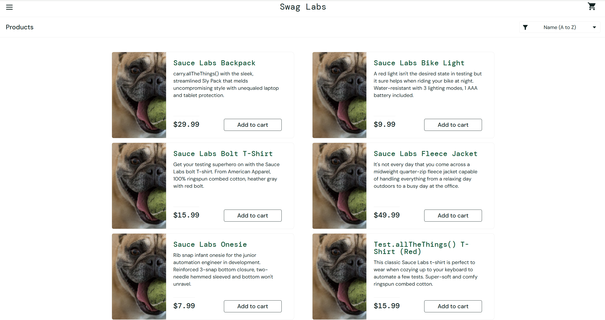

# Bug Report: BUG-001

**Title:** [Product] Ảnh sản phẩm hiển thị sai cho toàn bộ sản phẩm

---

**Environment:**  
OS: Windows 11  
Browser: Google Chrome (v156)

---

**Steps to Reproduce:**

1. Đăng nhập bằng tài khoản `problem_user`.
2. Mở trang Products.
3. Kiểm tra ảnh của cả 6 sản phẩm và đối chiếu với tên sản phẩm.

---

**Expected Result:**  
Mỗi sản phẩm hiển thị ảnh đúng với sản phẩm tương ứng.

---

**Actual Result:**  
Cả 6 sản phẩm đều sử dụng chung 1 ảnh, không khớp với tên sản phẩm.

---

**Severity:** Medium  
**Priority:** P2

---

**Attachments:**

* **Screenshots:**

  Trang Products: cả 6 sản phẩm đều hiển thị cùng một ảnh

  

* **[▶ Video Evidence](https://drive.google.com/file/d/1Dl-cMURinks7ngRaJAJyig8Og9mFuZ6e/view?usp=sharing)**
