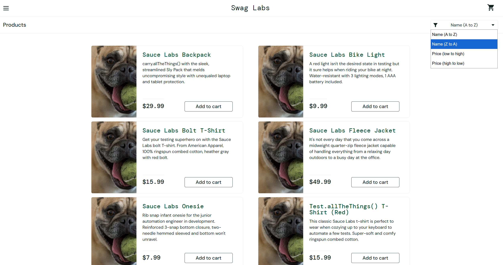

# Bug Report: BUG-002

**Title:** [Product] Bộ lọc sắp xếp sản phẩm (Name A-Z, Z-A, Price Low-High, High-Low) không hoạt động

---

**Environment:**  
OS: Windows 11  
Browser: Google Chrome (v156)

---

**Steps to Reproduce:**

1. Đăng nhập bằng tài khoản `problem_user`.
2. Mở trang Products.
3. Lần lượt chọn các tùy chọn sắp xếp:
   - `Name (A to Z)`
   - `Name (Z to A)`
   - `Price (low to high)`
   - `Price (high to low)`
4. Kiểm tra thứ tự tên và giá của các sản phẩm sau mỗi lần chọn.

---

**Expected Result:**  
Danh sách sản phẩm phải được sắp xếp lại tương ứng theo tùy chọn người dùng đã chọn.

---

**Actual Result:**  
Thứ tự danh sách sản phẩm giữ nguyên vị trí ban đầu, bộ lọc không thực hiện thao tác sort.

---

**Severity:** Medium  
**Priority:** P2

---

**Attachments:**

* **Screenshots:**

  Trang Products: mở dropdown sắp xếp và chọn `Name (Z to A)` nhưng danh sách sản phẩm không đổi thứ tự

  

* **[▶ Video Evidence](https://drive.google.com/file/d/1OUCqQutgvkg79ugL1uNCjsNiQysp80xN/view?usp=sharing)**
