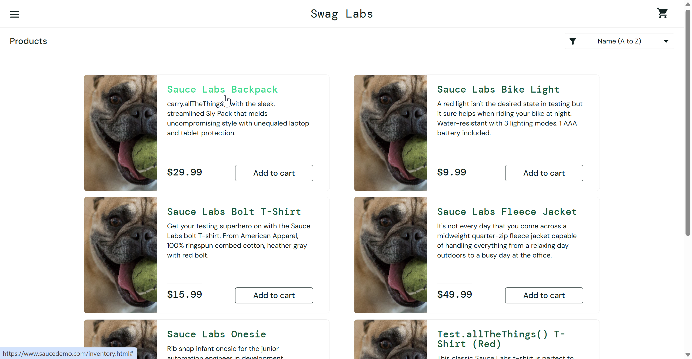
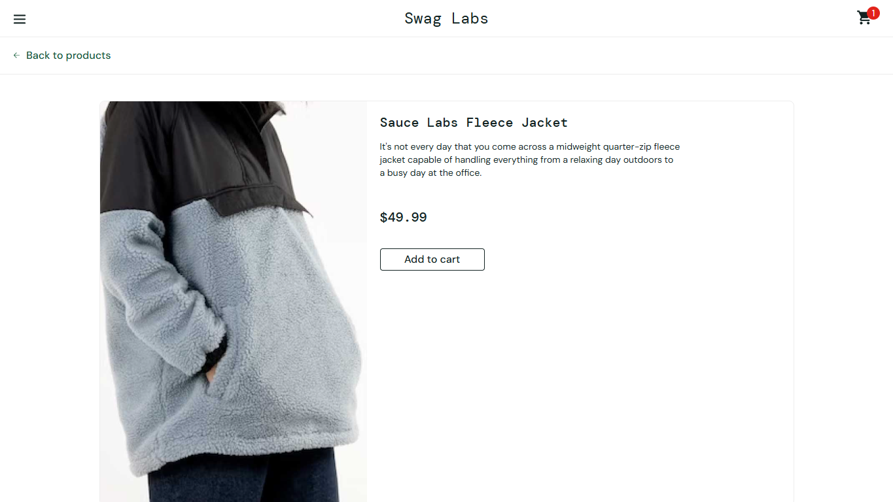

# Bug Report: BUG-003

**Title:** [Product Detail] Nhấn vào sản phẩm tại trang Products mở sai trang chi tiết sản phẩm khác

---

**Environment:**  
OS: Windows 11  
Browser: Google Chrome (v156)

---

**Steps to Reproduce:**

1. Đăng nhập bằng tài khoản `problem_user`.
2. Tại trang Products, bấm vào **tên** của một sản phẩm (ví dụ: `Sauce Labs Backpack`).
3. Đối chiếu tên, giá, mô tả và ảnh ở trang Product Detail với sản phẩm vừa chọn.
4. Bấm `Back to products`, rồi lặp lại với 5 sản phẩm còn lại.

---

**Expected Result:**  
Trang chi tiết hiển thị đúng sản phẩm vừa chọn(tên, giá, mô tả và ảnh).

---

**Actual Result:**  
Cả 6 sản phẩm đều mở sai trang chi tiết (một trường hợp hiển thị trang lỗi).

---

**Severity:** High  
**Priority:** P1

---

**Attachments:**

* **Screenshots:**

  Trang Products, bấm vào `Sauce Labs Backpack`

  

  Trang chi tiết mở ra là `Sauce Labs Fleece Jacket` ($49.99) thay vì Backpack

  

* **[▶ Video Evidence](https://drive.google.com/file/d/1ACGHdPF8mjl23kuBEdPoxKpj314WyzHh/view?usp=sharing)**
