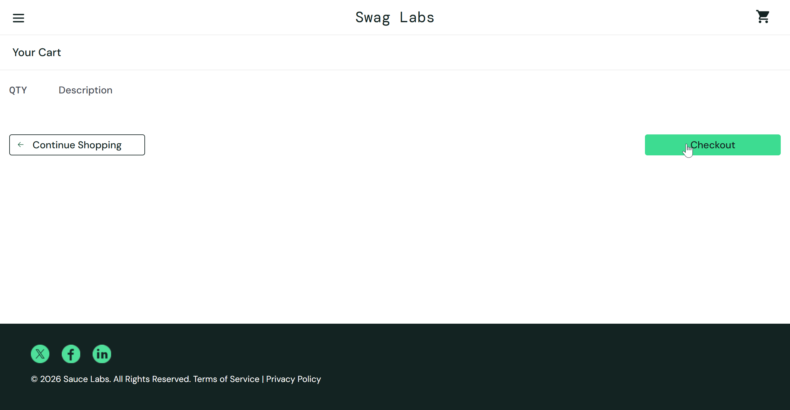
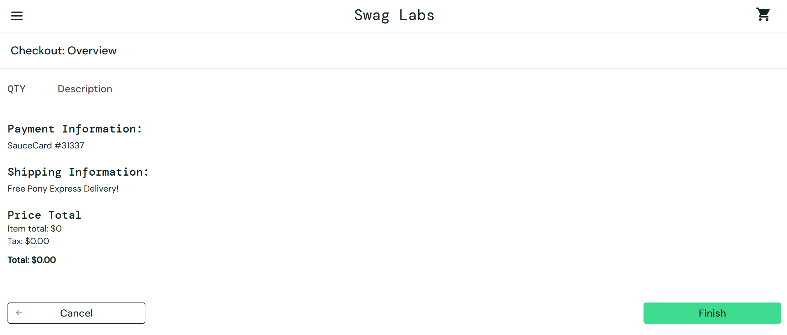

# Bug Report: BUG-004

**Title:** [Cart] Hệ thống cho phép thanh toán và hoàn tất đơn hàng khi giỏ hàng không có sản phẩm

---

**Environment:**  
OS: Windows 11  
Browser: Google Chrome (v156)

---

**Steps to Reproduce:**

1. Đăng nhập bằng tài khoản `standard_user`.
2. Bảo đảm giỏ hàng không có sản phẩm nào.
3. Nhấn vào icon giỏ hàng để mở trang Your Cart.
4. Nhấn nút `Checkout`.
5. Tại trang Checkout: Your Information, nhập First Name `Nguyen`, Last Name `Tester`, Zip/Postal Code `700000`, rồi nhấn `Continue`.
6. Tại trang Checkout: Overview, kiểm tra danh sách sản phẩm và tổng tiền, rồi nhấn `Finish`.

---

**Expected Result:**

- Nút `Checkout` bị vô hiệu hóa khi giỏ hàng trống.
- Hệ thống không chuyển sang trang Checkout và không cho hoàn tất đơn hàng.

---

**Actual Result:**

- Khi giỏ hàng trống, nút `Checkout` vẫn hoạt động và cho phép tiếp tục đến trang Checkout: Overview.
- Trang Overview không có sản phẩm, hiển thị `Item total: $0`, `Tax: $0.00` và `Total: $0.00`.
- Nút `Finish` vẫn hoạt động; hệ thống hoàn tất đơn hàng và hiển thị thông báo `Thank you for your order!`.

---

**Severity:** High  
**Priority:** P1

---

**Attachments:**

* **Screenshots:**

  Giỏ hàng trống nhưng nút `Checkout` vẫn click được

  

  Trang Checkout: Overview không có sản phẩm nào, tổng tiền là `$0.00`, nhưng nút `Finish` vẫn click được và cho phép hoàn tất đơn hàng

  

* **[▶ Video Evidence](https://drive.google.com/file/d/1KCdJYW-16fQtuVsBEl7vglClryxkQJEf/view?usp=sharing)**
