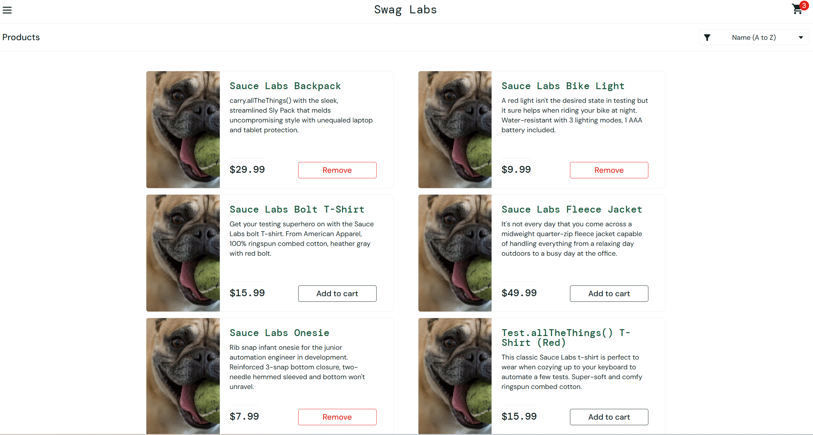

# Bug Report: BUG-005

**Title:** [Product] Nút Add to cart không hoạt động với một số sản phẩm trên trang Products

---

**Environment:**  
OS: Windows 11  
Browser: Google Chrome (v156)

---

**Steps to Reproduce:**

1. Đăng nhập bằng tài khoản `problem_user`.
2. Mở trang Products.
3. Lần lượt nhấn `Add to cart` cho cả 6 sản phẩm.
4. Kiểm tra trạng thái nút thao tác và Cart badge.

---

**Expected Result:**  
Cả 6 sản phẩm được thêm vào giỏ hàng, nút đổi thành `Remove` và số trên icon giỏ hàng hiển thị 6.

---

**Actual Result:**  
Chỉ thêm được 3 sản phẩm: `Sauce Labs Backpack`, `Sauce Labs Bike Light` và `Sauce Labs Onesie` vào giỏ hàng. Số trên icon giỏ hàng chỉ hiện 3.

---

**Severity:** High  
**Priority:** P1

---

**Attachments:**

* **Screenshots:**

  Trang Products sau khi nhấn `Add to cart` cho cả 6 sản phẩm (chỉ một số sản phẩm được thêm)

  

* **[▶ Video Evidence](https://drive.google.com/file/d/1I5q4vxlrcVr9Gi31ikL77EDHbsFUSSj9/view?usp=sharing)**
