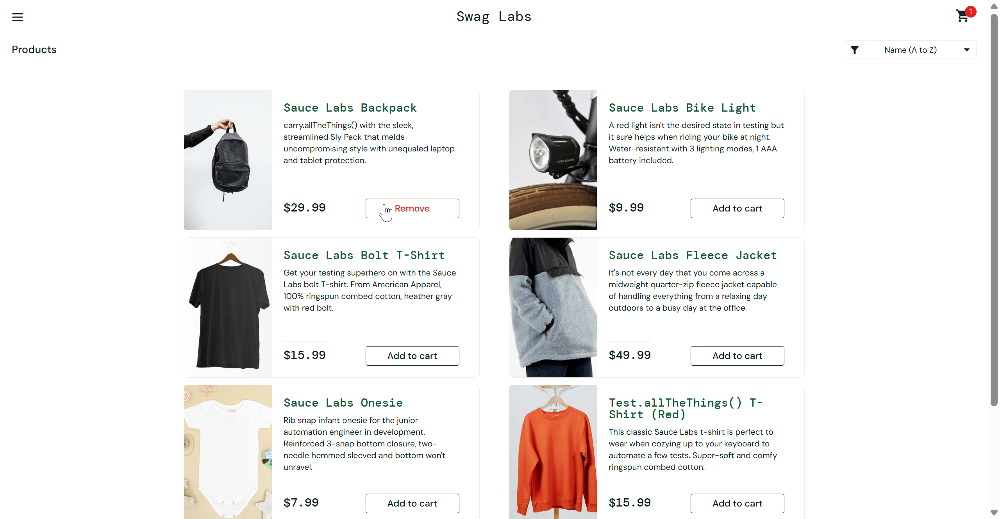

# Bug Report: BUG-006

**Title:** [Product] Nút Remove không hoạt động khi nhấn xóa sản phẩm khỏi giỏ hàng tại trang Products

---

**Environment:**  
OS: Windows 11  
Browser: Google Chrome (v156)

---

**Steps to Reproduce:**

1. Đăng nhập bằng tài khoản `error_user`.
2. Thêm sản phẩm`Sauce Labs Backpack` vào Cart.
3. Nhấn `Remove` của `Sauce Labs Backpack` tại trang Products.
4. Kiểm tra nút thao tác và Cart badge.

---

**Expected Result:**  
Sản phẩm được xóa khỏi giỏ hàng. Nút đổi lại thành `Add to cart` và số trên icon giỏ hàng về 0.

---

**Actual Result:**  
Nút `Remove` không có tác dụng, sản phẩm vẫn nằm nguyên trong danh sách giỏ hàng, icon giỏ hàng vẫn hiện số 1.

---

**Severity:** Medium  
**Priority:** P2

---

**Attachments:**

* **Screenshots:**

  Nút `Remove` không hoạt động khi nhấn xóa sản phẩm tại trang Products, icon giỏ hàng vẫn giữ số 1

  

* **[▶ Video Evidence](https://drive.google.com/file/d/1_RGEpxlt77MLPa17MZ5uTtMLfYNHak5-/view?usp=sharing)**
