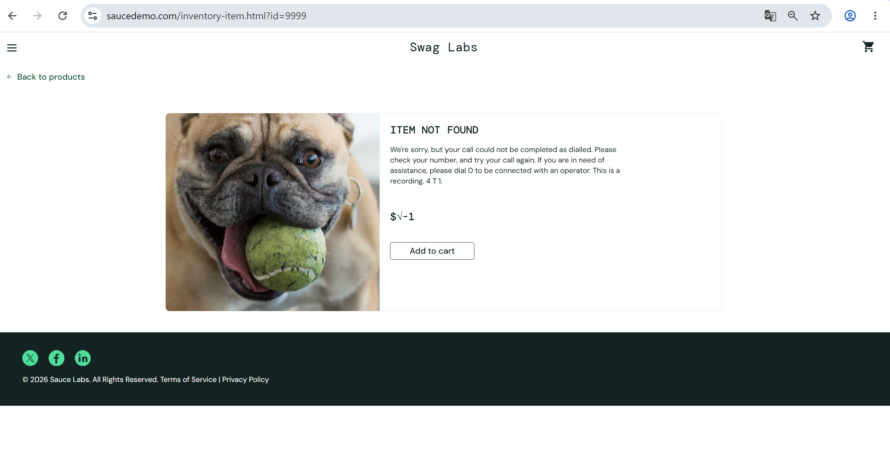

# Bug Report: BUG-007

**Title:** [Product Detail] Sản phẩm không tồn tại vẫn hiển thị nút Add to cart

---

**Environment:**  
OS: Windows 11  
Browser: Google Chrome (v156)

---

**Steps to Reproduce:**

1. Đăng nhập bằng tài khoản `standard_user`.
2. Truy cập trực tiếp `/inventory-item.html?id=9999`.
3. Kiểm tra nội dung Product Detail và các nút thao tác.

---

**Expected Result:**  
Hệ thống hiển thị thông báo không tìm thấy sản phẩm và không hiển thị giá hay nút `Add to cart`.

---

**Actual Result:**  
Trang hiển thị `ITEM NOT FOUND`, giá `$√-1` và có nút `Add to cart` cho sản phẩm không tồn tại.

---

**Severity:** Medium  
**Priority:** P3

---

**Attachments:**

* **Screenshots:**

  Trang Product Detail của sản phẩm không tồn tại (ID: 9999) vẫn hiển thị nút `Add to cart`

  

* **[▶ Video Evidence](https://drive.google.com/file/d/1BmzcEoFIH5Z3K73ZYaccrxppl5DO6jqa/view?usp=sharing)**
