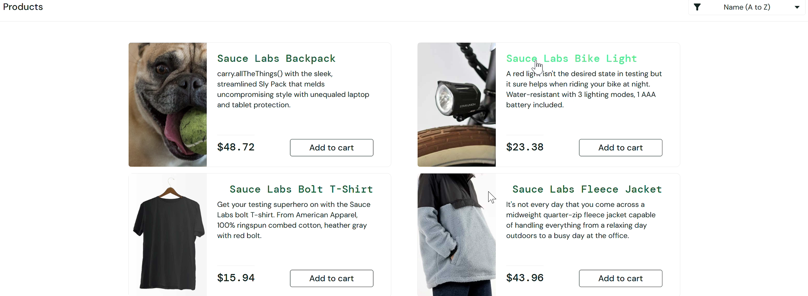
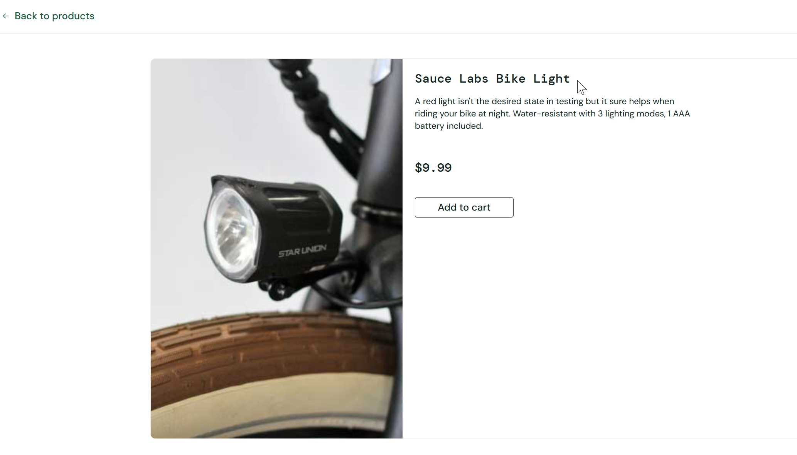

# Bug Report: BUG-009

**Title:** [Product] Giá các sản phẩm trên trang Products thay đổi sau mỗi lần tải lại và không khớp với Product Detail

---

**Environment:**  
OS: Windows 11  
Browser: Google Chrome (v156)

---

**Steps to Reproduce:**

1. Đăng nhập bằng tài khoản `visual_user`.
2. Tại trang Products, quan sát giá của `Sauce Labs Bike Light`.
3. Tải lại trang nhiều lần và quan sát giá tiếp tục thay đổi sau mỗi lần tải.
4. Nhấn vào tên `Sauce Labs Bike Light` để mở trang Product Detail và ghi nhận giá.
5. So sánh giá ở Product Detail với các giá đã ghi nhận ở trang Products.

---

**Expected Result:**  
Giá hiển thị trên trang Products phải giữ nguyên sau mỗi lần tải lại trang và phải khớp với giá ở Product Detail của cùng sản phẩm.

---

**Actual Result:**  
Giá của các sản phẩm trên trang Products thay đổi ngẫu nhiên sau mỗi lần tải lại trang, và không khớp với giá cố định hiển thị tại trang Product Detail.

---

**Severity:** High  
**Priority:** P1

---

**Attachments:**

* **Screenshots:**

  Trang Products: `Sauce Labs Bike Light` có giá $23.38

  

  Trang Product Detail của `Sauce Labs Bike Light` có giá $9.99

  

* **[▶ Video Evidence](https://drive.google.com/file/d/1kJBBjZudBmmLCw3dwhInZ3fzmLeWV4GH/view?usp=sharing)**
