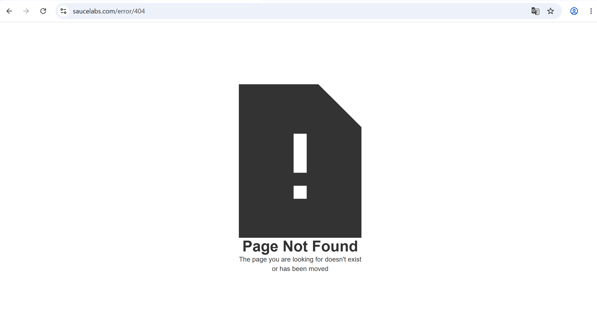

# Bug Report: BUG-010

**Title:** [Navigation] Liên kết About trong Sidebar menu mở trang lỗi 404

---

**Environment:**  
OS: Windows 11  
Browser: Google Chrome (v156)

---

**Steps to Reproduce:**

1. Đăng nhập bằng tài khoản `problem_user`.
2. Nhấn vào icon Menu ở góc trên bên trái để mở Sidebar menu.
3. Chọn `About`.
4. Kiểm tra URL và nội dung trang được mở.

---

**Expected Result:**  
Mục `About` mở trang chủ chính thức của Sauce Labs (`https://saucelabs.com/`).

---

**Actual Result:**  
Liên kết trỏ đến `https://saucelabs.com/error/404` và hiển thị trang không tồn tại.

---

**Severity:** Medium  
**Priority:** P2

---

**Attachments:**

* **Screenshots:**

  Nhấn liên kết `About` trong Sidebar menu mở ra trang báo lỗi 404

  

* **[▶ Video Evidence](https://drive.google.com/file/d/1PRyHkv1iMsRvmRiavTUKvSIUgRpuxtRS/view?usp=sharing)**
