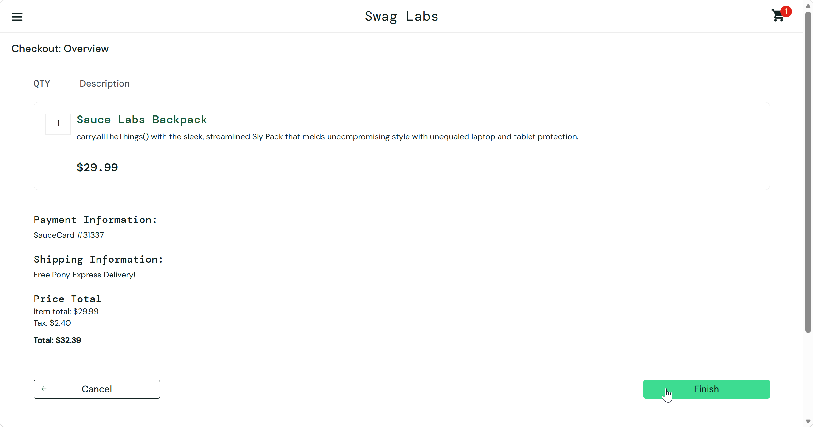

# Bug Report: BUG-011

**Title:** [Checkout] Nút Finish không hoạt động, không hoàn tất được đơn hàng

---

**Environment:**  
OS: Windows 11  
Browser: Google Chrome (v156)

---

**Steps to Reproduce:**

1. Đăng nhập bằng tài khoản `error_user`.
2. Thêm `Sauce Labs Backpack` vào Cart.
3. Mở Cart, nhấn Checkout.
4. Tại Checkout: Your Information, nhập First Name: Nguyen.
5. Nhập Last Name `Tester` (trường Last Name không hiển thị giá trị đã nhập).
6. Nhập Zip/Postal Code: `700000`, nhấn Continue.
7. Chọn `Finish`.

---

**Expected Result:**

- Hệ thống chuyển đến /checkout-complete.html.
- Trang hiển thị thông báo xác nhận đặt hàng thành công.

---

**Actual Result:**

- Sau khi nhấn Finish, trang không chuyển hướng, vẫn ở /checkout-step-two.html.
- Đơn hàng không được hoàn tất, giỏ hàng vẫn còn sản phẩm.

---

**Severity:** Critical  
**Priority:** P1

---

**Attachments:**

* **Screenshots:**

  Trang Checkout: Overview: Nhấn nút `Finish` không hoạt động, đơn hàng không hoàn tất được

  

* **[▶ Video Evidence](https://drive.google.com/file/d/1ddwspgcbKXwX3dbbDlE4QLDyqLMpB33u/view?usp=sharing)**
