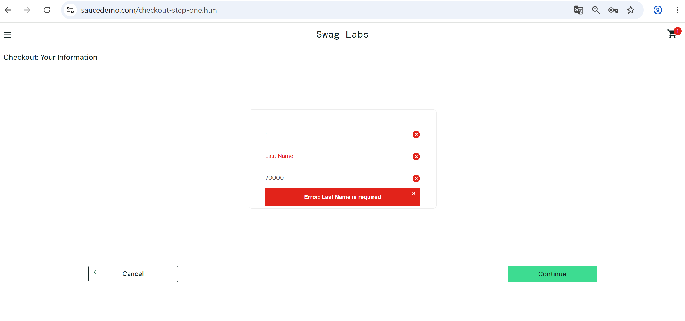

# Bug Report: BUG-012

**Title:** [Checkout] Nhập Last Name bị ghi đè vào First Name, không thể tiếp tục thanh toán

---

**Environment:**  
OS: Windows 11  
Browser: Google Chrome (v156)

---

**Steps to Reproduce:**

1. Đăng nhập bằng tài khoản `problem_user`.
2. Thêm một sản phẩm vào Cart và bắt đầu quy trình Checkout.
3. Nhập `Nguyen` vào trường First Name.
4. Nhập `Tester` vào trường Last Name.
5. Nhập `700000` vào trường Zip/Postal Code.
6. Nhấn `Continue`.

---

**Expected Result:**

- Giá trị `Tester` hiển thị trong trường `Last Name`, trường `First Name` giữ nguyên `Nguyen`.
- Khi nhấn `Continue`, hệ thống chuyển sang trang Checkout: Overview (`/checkout-step-two.html`).

---

**Actual Result:**

- Ký tự gõ vào trường `Last Name` bị ghi vào trường `First Name`, trường `Last Name` vẫn trống.
- Khi nhấn `Continue`, hệ thống báo lỗi `Error: Last Name is required`, người dùng không thể tiếp tục thanh toán.

---

**Severity:** Critical  
**Priority:** P1

---

**Attachments:**

* **Screenshots:**

  Trang Checkout: Your Information sau khi nhập: First Name bị ghi đè, Last Name trống, báo lỗi

  

* **[▶ Video Evidence](https://drive.google.com/file/d/1UozwBud-9JzrsGqAjFqoqzR3Bihevq0r/view?usp=drive_link)**
